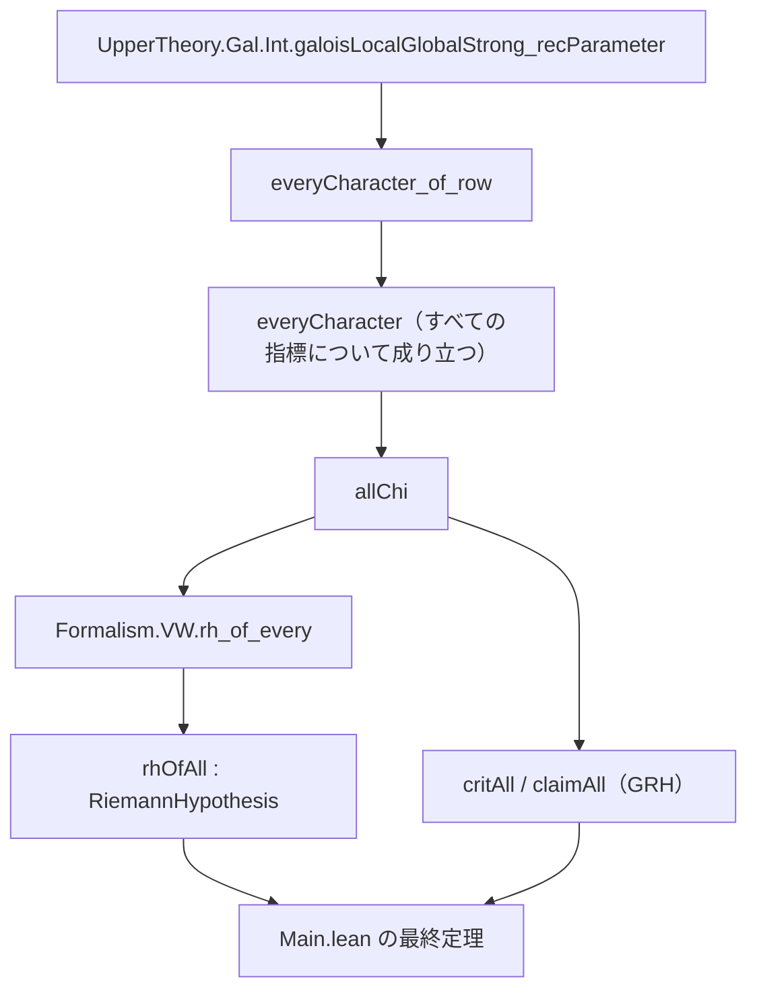
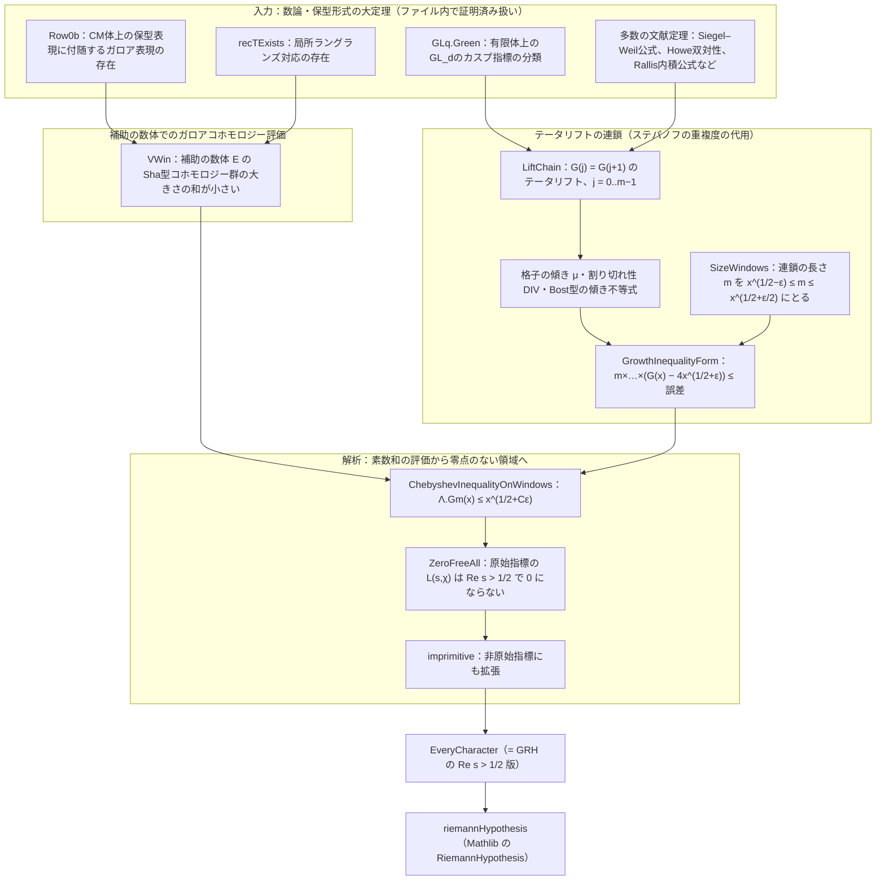

# リーマン予想とGRHの証明発表（2026-11-20） — Leanファイル調査

発表文の脚注にあるLeanの形式化ファイル（`https://alpo.ge/lean.tar.gz.part01`〜`part14`）をダウンロードして、中身をざっと調べた記録です。

> **この調査の範囲**：ファイルを**ビルド（Leanでの検査）はしていません**。行ったのは、ソースコードの集計・文字列検索と、主要ファイルの目視確認だけです。そのため「Leanの検査を本当に通るか」は確認できていません。わかったのは「通るとしたら何が証明されたことになるか」と「目立つ抜け道があるか」です。

調査日：2026-11-27

## 1. 規模

| 項目 | 値 |
|---|---|
| ダウンロードサイズ（gzip圧縮、14分割） | 約239MB（part01〜13が各18MB、part14が約5.3MB） |
| 展開後のサイズ | 約1,031MB |
| ファイル数 | 175,190（うち `.lean` が175,187） |
| 総行数 | 約1,737万行 |
| `theorem` / `lemma` の数 | 約81万3千 |
| Leanのバージョン | `leanprover/lean4:v4.33.1` |
| 依存ライブラリ | Mathlib（コミット `0df444a3…` に固定） |

- 中身はすべてソースコードで、コンパイル済みファイル（`.olean`）や論文PDFは入っていません。
- 1,737万行は、Lean最大の数学ライブラリ Mathlib の数倍〜10倍程度にあたる規模です。発表文の「とても長い」は誇張ではありません。
- アーカイブ内のファイルは、日付が1970年1月1日、所有者がrootにそろえられています。配布用に正規化したものとみられ、特に意味はありません。

### フォルダ構成（`lean/src/` 直下）

| フォルダ | ファイル数 | 推測される役割（名前から） |
|---|---|---|
| `Development` | 141,928 | 証明の本体（アーベル多様体、保型スペクトル、エタールコホモロジー、ヴェイユ評価など） |
| `Formalism` | 18,254 | 正値性・行列式・局所から大域への議論など |
| `GroundTheory` | 8,507 | 基礎理論（局所体・大域体、p進ホッジ理論、テータ、関数体など） |
| `ReciprocityTheory` | 3,845 | 相互法則・ガロア表現 |
| `CompanionTheory` | 2,027 | 保型形式の補助理論（ベッセル周期、ハリシュ＝チャンドラ加群など） |
| `PositivityTheory` | 449 | 正値性 |
| `Lemmata` | 167 | 補題集 |
| `BuildAid` | 5 | ビルド補助 |
| `Supplements` | 3 | 最終定理をまとめるファイル |
| `Main.lean`・`Statements.lean` | 各1 | **最終定理と、その主張の定義** |

## 2. 何が証明されたことになっているか（最重要）

### 2.1 最終定理（`Main.lean`）

```lean
theorem riemannHypothesis : RiemannHypothesis := rhOfAll
theorem riemannZeta_eq_zero_re : RiemannZetaZerosOnLine := rhOfAll
theorem LFunction_ne_zero_of_half_lt_re : DirichletLNonvanishingRightOfHalf := allChi
theorem LFunction_eq_zero_re : DirichletLZerosOnLine := claimAll.2.1
theorem LFunction_eq_zero_re_of_isPrimitive : PrimitiveDirichletLZerosOnLine := critAll
```

- 1つ目の `RiemannHypothesis` は、**Mathlib に最初から入っている「リーマン予想」の定義**です。著者が自分で定義したものではありません。「自分で都合よく定義した弱い主張を証明した」というよくある問題は、少なくともリーマン予想についてはありません。
- 最終定理には仮定（`(h : …)` のような引数）が付いていません。**何の前提もなしに主張が成り立つ**、という形です。

### 2.2 GRH（ディリクレL関数版）の主張（`Statements.lean`）

```lean
def RiemannZetaZerosOnLine : Prop :=
  ∀ s : ℂ, riemannZeta s = 0 → (¬∃ n : ℕ, s = -2 * ((n : ℂ) + 1)) → s ≠ 1 → s.re = 1 / 2

def DirichletLZerosOnLine : Prop :=
  ∀ (N : ℕ) [NeZero N] (χ : DirichletCharacter ℂ N) (s : ℂ),
    0 < s.re → s.re < 1 → DirichletCharacter.LFunction χ s = 0 → s.re = 1 / 2
```

- 1つ目は、Mathlib の `RiemannHypothesis` と同じ内容を書き直したものです。
- 2つ目は「すべてのディリクレ指標 χ について、L関数の0 < Re s < 1 にある零点は実部が1/2」で、**ディリクレL関数についての一般化リーマン予想（GRH）**の標準的な形です。
- 「Re s > 1/2 ではL関数が0にならない」という形と、原始指標に限った形も別に述べられています。
- 発表文の「GRH」は、**ディリクレL関数の範囲**で形式化されていることになります。保型L関数一般に対する、より広いGRHではありません。

### 2.3 証明のつながり



- `RiemannHypothesisOfEveryCharacter.lean` では、「Re s > 1/2 でゼータが0にならない」ことと関数等式（s と 1−s の対称性）から、零点が Re s = 1/2 上にあることを導いています。ここは教科書どおりの標準的な最後の一歩です。

## 3. 抜け道がないかの確認

Leanでは、次のようなものが混ざっていると「検査を通ったのに実は証明になっていない」ことが起こります。全ファイルを検索しました。

| 検索したもの | 意味 | 結果 |
|---|---|---|
| `sorry` / `admit` | 「ここは証明を省略」という印 | **0件** |
| `axiom` 宣言 | 証明なしで正しいと認める前提を足す | **0件** |
| `native_decide` / `ofReduceBool` | 検査の一部を高速な（検証されていない）計算に任せる | **0件** |
| `implemented_by` / `@[extern]` | 中身を別の実装に差し替える | **0件** |
| `unsafe` 宣言 / `opaque` | 安全性の検査を外す宣言 | **0件** |
| `debug.skipKernelTC` | カーネルによる型検査を飛ばす | **0件** |
| プログラムから宣言を直接追加（`addDecl`） | 公理を間接的に追加できる手段 | 2件（`CutCptCopy.lean`）。どちらも定義・定理の**コピー**（`defnDecl`・`thmDecl`）で、カーネルの検査を通る種類。公理の追加ではない |
| `set_option allowUnsafeReducibility` | 証明を組み立てる段階の設定 | 37件。最終的なカーネル検査は外れないので、正しさには影響しない |
| `maxHeartbeats 0` | 計算時間の上限を外す | 4件。正しさには影響しない（時間がかかるだけ） |
| 中身が `True` だけの命題 | 「何も言っていない」主張にすり替える | 1件（`TrivialCondition`という名前の補助条件）。最終定理の主張には関係しない |

**結論**：文字列検索の範囲では、**よく知られた抜け道は見当たりません**。最終定理は Mathlib の定義そのものを、仮定なしで、公理を足さずに証明していることになっています。

### 3.1 「公表済みの定理」の扱い

`PublishedTheorems` というフォルダが複数あり、ファイル数は1,073、そこで定義されている命題は757個あります。たとえば Ferrero–Washington の定理（岩澤理論のμ不変量の消滅）や、Gelfand–Kazhdan、Kisin の結果など、**既存の論文で証明された定理**の主張が `def … : Prop` として書かれています。

- これらは `axiom` ではなく、ただの命題の定義です。証明の途中では、`Hypotheses2.lean`・`MinimalHyps.lean` のように**仮定として受け取る形**で使われている箇所があります。
- ただし最終定理には仮定がなく、公理も0件です。そのため、**ビルドが通るのであれば、これらの「公表済みの定理」も最終的にはすべてファイル内で証明されている**ことになります（されていなければ、型が合わずにビルドが失敗します）。
- 実際に `GelfandKazhdanReal` は別の命題（`StrongMultOneReal`）から導く定理があり、Ferrero–Washington には `FerreroWashingtonIndex` という大きなフォルダがありました。既存の深い定理を、ゼロから形式化し直している様子がうかがえます。これが1,700万行という規模の一因と考えられます。

## 4. わからないこと・確認が必要なこと

1. **本当にビルドが通るか**：これが最大の未確認点です。1,700万行のビルドには、大型マシンで長時間かかる見込みです。手元のMacで試すのは現実的ではありません（Mathlib だけでも数GBのディスクと長いビルド時間が必要です）。
2. **`#print axioms riemannHypothesis` の結果**：ビルド後にこのコマンドを実行すると、証明が依存する公理の一覧が出ます。Lean標準の3つ（`propext`・`Classical.choice`・`Quot.sound`）だけなら、抜け道がないことの決定的な確認になります。今回の文字列検索は、その代わりにはなりません。
3. **Lean本体・Mathlibの正しさ**：形式化の正しさは、最終的にLeanのカーネルとMathlibの定義（`riemannZeta`・`DirichletCharacter.LFunction` など）が正しいことに依存します。どちらも広く使われていますが、前提として残ります。
4. **人間が理解できる証明か**：機械検査が通っても、数学者が議論の筋を理解・再構成できるかは別の問題です。発表文の著者自身も、人間向けの論文はこれから書くと述べています。

## 5. 証明の幹（追跡調査）

最終定理から上流へ、定義と証明を1つずつ読んでたどった結果です（2回目の調査、2026-11-27）。約106万個の宣言の索引を作り、名前から定義を引いて読み進めました。

> **読み方の注意**：各段について、「中身を読んで確認したもの」と「名前や型から推測したもの」を分けて書きます。ビルドしていないので、各段の証明が本当に通るかは確認していません。

### 5.1 全体像



### 5.2 各段の詳細

#### ① 最後の一歩：零点のない領域 → リーマン予想（中身を確認）

- `RiemannHypothesisOfEveryCharacter.lean`：「Re s > 1/2 でゼータが0にならない」ことと関数等式（s と 1−s の対称性）から、零点が Re s = 1/2 上にあることを導いています。教科書どおりの議論です。
- `UpperTheory.EveryCharacter` の定義は「すべてのディリクレ指標 χ について、Re s > 1/2 なら L(s, χ) ≠ 0」です。中身を確認しました。
- `UpperTheory.Top.imprimitive`：原始指標で示せば、非原始指標にも広がることを示しています。非原始指標の L 関数は、原始指標の L 関数に有限個のオイラー因子 (1 − χ(p)p^(−s)) を掛けたもので、その因子は Re s > 0 では 0 にならない、という標準的な議論です。中身を確認しました。

#### ② 解析の核：素数和の評価 → 零点のない領域（定義を確認）

- `Formalism.HC.ZeroFreeAll` は「すべての原始指標 ψ について、Re s > 1/2 で零点がない」という定義です。
- `ChebyshevInequalityOnWindows` は、指標で重み付けした素数和 Λ.Gm(x) が、ある「窓」（x の範囲）の上で **Λ.Gm(x) ≤ x^(1/2 + (eD+eL+7)ε)** を満たす、という条件です。
- `level_of_tiedWin` は、この評価から零点がないことを導いています。素数和が x^(1/2+ε) で抑えられれば Re s > 1/2 に零点がない、というのは明示公式による標準的な議論です。
- 窓は x ∈ [Y, Y²] の形をしています（`VWinAt`）。すべての x ではなく、窓の上だけで評価できれば十分な作りです。

#### ③ ステパノフ型の議論：連鎖の長さ √x（定義を確認）

ここが証明の新しい核心で、発表文の主張とはっきり対応しています。

- `GrowthInequalityForm`（`GrowthBoundGivesRiemannHypothesis.lean`）は、おおむね次の形の不等式です。

  > |TT| × **m** × b × (δ/2) × ( G(x) − 4·x^(1/2+ε) ) ≤ 誤差 ＋ 2·|TT|·m·b/x

- `SizeWindows` によって、連鎖の長さ m は **x^(1/2−ε) ≤ m ≤ x^(1/2+ε/2)**、つまりほぼ √x に固定されています。誤差の上限も m・n・k などで具体的に決められています。
- `GrowthSizeBound` は、この2つから **G(x) ≤ x^(1/2+(C+3)ε)** を結論します。
- 仕組みはこうです。左辺の主要項は m 倍されますが、誤差は m を増やしてもそれほど大きくなりません。そのため、G(x) が 4x^(1/2+ε) を大きく超えると、左辺が誤差を上回って矛盾します。これは、ステパノフの方法で「重複度 m を稼ぐと主要項だけが m 倍になる」という構造とそっくりです。
- 発表文の「長さ X の von Mangoldt 和に対して、Claude が提案した連鎖の長さは √X」という一文は、この `x ^ ((1 : ℝ) / 2 - ε) ≤ m` という条件に当たります。同じ条件は `RestSize` にもあります。

#### ④ 連鎖の中身：テータリフトと格子の傾き（定義を確認、つながりは一部推測）

- **`LiftChain`**（`Divisibility/ZetaProductPairs.lean`）は、一番上の段の保型形式 G(m) から始めて、j < m のそれぞれで **G(j) は G(j+1) のテータリフト** とする、m 段の連鎖です。各段は空間 `D.sp.Y j` 上のカスプ形式です。
- **`DefiniteLiftChain`** では、各段の保型表現 π_j をカスプ表現にとり、π_{j+1} の元を「指標 μ(j+1) で捻った π_j のテータリフトの和」として書いています。発表文の項目8「総定値ユニタリ群の間の反復テータリフト π ↦ π ⊞ μ_j[t] で重複度 m を稼ぐ」に当たります。
- **`DefiniteChainFromRallis`** は、この連鎖を、Rallis の議論（テータのカスプ性、Witt指数の条件、補助の指標の存在、周期の存在）から作る形になっています。発表文の項目12「シーソー（Rallis）」とつながります。
- 連鎖の数値データ（`RankGapBounds.WeightedMeanData.Data`）には、次のものが入っています。
  - 格子の傾き μ、μ_max（Harder–Narasimhan 型の量）。`QuotientSlopeBoundsWith` は傾きの不等式で、アラケロフ幾何の **Bost の傾き不等式**（項目13）の形です。
  - `DIV`：割り切れ性の下からの評価で、項目9・10「m 回反復したリフトの割り切れ性」に当たります。
  - `EeJ u0 u j`（j = 0..m−1）：連鎖の各段の大きさ。`TieLocal` で `(Fm.L x i).E u (j+1)`、つまり連鎖の j+1 段目のデータと結び付けられています。
- **推測にとどまる点**：`LiftChain` で作った連鎖が、③の不等式の `Data` にどう流し込まれるかの途中（`FamP` の構成）は、名前と型からのつながりしか確認できていません。
- 関連する名前として、`ChowlaSelbergPeriod`（項目9）、`SiegelMassRatio`（項目9のSiegel質量公式）、`BehrendSets`（項目19）、`LatSeeSaw`・`SeeSaw`（項目12）も見つかりました。中身は読んでいません。

#### ⑤ もう1つの入力：補助の数体のガロアコホモロジー（定義を確認）

- `VWin` は、すべての原始指標 ψ について `VWinAt ψ 401` が成り立つ、という条件です。
- 中身は、補助の数体 E（`IsChiField`）について、**ガロアコホモロジー群の長さ `shaLen`（Sha型の群）の、素数 ℓ にわたる重み付きの和**が √(exp(x^ε)) 以下になる、というもの（`VVle`）です。
- E は円分体の部分体で、次の条件で切り出されます。
  - 2^(e+2) を法とする条件（a ≡ ±1）。**2べきの塔**になっており、発表文の項目11「岩澤塔」に当たると考えられます。
  - 指標 ψ の核。
  - 2つの素数 q, d のヤコビ記号。q ≡ 3 (mod 8)、d ≡ 7 (mod 16)、q | d+1 で、d+1 は Y^(ε/5) 以下の奇素数で全部割り切れる、という細かい条件があります（`WinPair`）。
- これは発表文の項目17「ひねりで消せない H¹(o_E[1/ℓ], Q_ℓ/Z_ℓ(−e)) の類と戦う（Vandiver予想の弱い形）」に当たると考えられます。
- `VWin` は `vwin_of_row` で、①のガロア表現の存在（`Row0b`）と底変換（`baseChangeN`）から導かれています。

#### ⑥ 一番の入力：既知の大定理（定義を確認）

- **`GalStar.Row0b`**：CM体 E 上の GL(a) の、正則代数的で偏極されたカスプ保型表現 π に、ℓ進ガロア表現 r が付随する、という主張です。Harris–Lan–Taylor–Thorne、Scholze、Chenevier–Harris らによる既知の大定理の形式化です。
- これは `galoisLocalGlobalStrong_recParameter` から得られ、さらに `galoisRepresentations_of_thetaLift`（テータリフトと幾何から）→ `tLiftK` と続きます。この先は追っていません。
- **`recTExists`**：GL の局所ラングランズ対応の存在。Harris–Taylor、Henniart、Scholze の定理に当たります。
- **`GLq.Green`**：有限体 F_g 上の GL_d のカスプ指標は、既約多項式で分類され、次数が ∏_{i=1}^{d−1}(g^i − 1) になる、という Green の定理（1955年）です。
- **`OpenLiteratureStatements`**：名前は「文献の定理の入れ物」ですが、中身は上の3つ（ガロア表現の存在×2、局所ラングランズ）だけです。そこから取り出しているように見える特異点解消・Fargues・Zarhin・Grothendieck変形理論などの「文献定理」は、実際には入れ物を使わず、ファイル内で証明された定理（`..._holds` など）を返しています。

### 5.3 発表文の時系列との対応表

| 発表文の項目 | Leanで見つかったもの | 確度 |
|---|---|---|
| 「長さ X の和に、長さ √X の連鎖」 | `SizeWindows`・`RestSize` の `x^(1/2−ε) ≤ m` | 高（定義を確認） |
| 5. Λ への切り替え、ギナン＝ヴェイユ | `ChebyshevInequalityOnWindows` の素数和 Λ.Gm(x)、`Dd.gam = オイラー定数`、`logDerivativeAtOne` | 中（定義を確認、明示公式の本体は未読） |
| 8. 反復テータリフト、重複度 m | `LiftChain`・`DefiniteLiftChain` | 高（定義を確認） |
| 9・10. 割り切れ性、Chowla–Selberg、Siegel質量 | `Data.DIV`、`ChowlaSelbergPeriod`、`SiegelMassRatio` | 中（DIVは確認、他は名前のみ） |
| 11. 岩澤塔 | `IsChiField` の 2^(e+2) 条件 | 中（推測） |
| 12. シーソー、Rallis | `DefiniteChainFromRallis`、`SeeSaw`、`LatSeeSaw` | 中（名前と型） |
| 13. Bostの傾き不等式 | `QuotientSlopeBoundsWith`、傾き μ・μ_max | 中（形が一致） |
| 14. 各リフトの「コスト」 | `CostWindows`、`moveCost`、`LossBounds` | 低〜中（名前と式の形） |
| 17. Vandiver の弱い形 | `VVle` の `shaLen`（ガロアコホモロジーの長さ） | 中（定義を確認） |
| 19. Behrend | `Formalism.BehrendSets` | 低（名前のみ） |

**訂正**：`BoundAtTwoThree` という名前を見て、項目14の「2/3で止まる」と対応すると最初は推測しましたが、誤りでした。定義を読むと、剰余標数が 2 または 3 の素点（ℓ = 2, 3）での評価のことでした。

### 5.4 追えなかったところ

- **連鎖から不等式へのつなぎ**：`LiftChain` で作った連鎖が、③の不等式の `Data`（`FamP` の各成分）にどう組み込まれるかの途中。`shapeWin` の証明は数十個の前提をつなぐ巨大な組み立てで、その一つひとつまでは読めていません。
- **明示公式そのもの**：素数和と零点を結ぶ公式は、名前と使われ方から存在を推測しただけで、本体は読んでいません。
- **各入力の証明の中身**：ガロア表現の存在、局所ラングランズ対応、Siegel–Weil公式などは、主張は確認しましたが、ファイル内でどう証明されているかは追っていません。これらだけで、それぞれ数十万〜数百万行ある可能性があります。

## 6. まとめ（1行で）

**約1,700万行・81万定理という巨大な形式化で、最終定理は Mathlib 標準の `RiemannHypothesis` とディリクレL関数のGRHを仮定なし・追加公理なしで主張しており、文字列検索では抜け道が見つからなかった。幹をたどると、「テータリフトを約√x段つないだ連鎖で重複度を稼ぎ、素数和を x^(1/2+ε) で抑える」という発表文どおりの構造が実際にコードに現れていた。ただしビルドが通るかは未確認で、それが判定の決め手になる。**

## 付録：調査の方法

- 14分割ファイルを一時フォルダにダウンロードし、つなげたgzipを展開せずに流し読みした（Python の `tarfile` をストリームモードで使用）。
- 各ファイルについて、行数・定理数・上の表のキーワードを集計した。
- `Main.lean`・`Statements.lean`・`Supplements/`・設定ファイル（`lakefile.toml`・`lake-manifest.json`・`lean-toolchain`）と、公表済み定理のファイルの一部を目視で確認した。
- 2回目の調査では、展開したソース（約1.3GB）から宣言の索引（約106万件）を作り、名前から定義を引いて読み進めた。
- ダウンロード・展開したファイルは、どちらの調査でも作業後にすべて削除した。
