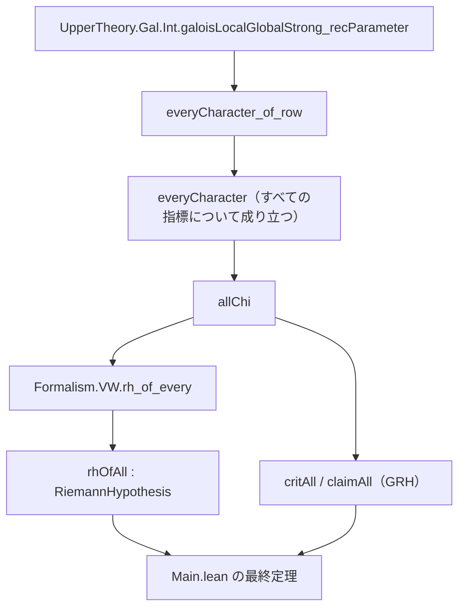

# リーマン予想とGRHの証明発表（2026-11-20） — Leanファイル調査

発表文の脚注にあるLeanの形式化ファイル（`https://alpo.ge/lean.tar.gz.part01`〜`part14`）をダウンロードして、中身をざっと調べた記録です。

> **この調査の範囲**：ファイルを**ビルド（Leanでの検査）はしていません**。行ったのは、ソースコードの集計・文字列検索と、主要ファイルの目視確認だけです。そのため「Leanの検査を本当に通るか」は確認できていません。わかったのは「通るとしたら何が証明されたことになるか」と「目立つ抜け道があるか」です。

調査日：2026-11-27

## 1. 規模

| 項目 | 値 |
|---|---|
| ダウンロードサイズ（gzip圧縮、14分割） | 約239MB（part01〜13が各18MB、part14が約5.3MB） |
| 展開後のサイズ | 約1,031MB |
| ファイル数 | 175,190（うち `.lean` が175,187） |
| 総行数 | 約1,737万行 |
| `theorem` / `lemma` の数 | 約81万3千 |
| Leanのバージョン | `leanprover/lean4:v4.33.1` |
| 依存ライブラリ | Mathlib（コミット `0df444a3…` に固定） |

- 中身はすべてソースコードで、コンパイル済みファイル（`.olean`）や論文PDFは入っていません。
- 1,737万行は、Lean最大の数学ライブラリ Mathlib の数倍〜10倍程度にあたる規模です。発表文の「とても長い」は誇張ではありません。
- アーカイブ内のファイルは、日付が1970年1月1日、所有者がrootにそろえられています。配布用に正規化したものとみられ、特に意味はありません。

### フォルダ構成（`lean/src/` 直下）

| フォルダ | ファイル数 | 推測される役割（名前から） |
|---|---|---|
| `Development` | 141,928 | 証明の本体（アーベル多様体、保型スペクトル、エタールコホモロジー、ヴェイユ評価など） |
| `Formalism` | 18,254 | 正値性・行列式・局所から大域への議論など |
| `GroundTheory` | 8,507 | 基礎理論（局所体・大域体、p進ホッジ理論、テータ、関数体など） |
| `ReciprocityTheory` | 3,845 | 相互法則・ガロア表現 |
| `CompanionTheory` | 2,027 | 保型形式の補助理論（ベッセル周期、ハリシュ＝チャンドラ加群など） |
| `PositivityTheory` | 449 | 正値性 |
| `Lemmata` | 167 | 補題集 |
| `BuildAid` | 5 | ビルド補助 |
| `Supplements` | 3 | 最終定理をまとめるファイル |
| `Main.lean`・`Statements.lean` | 各1 | **最終定理と、その主張の定義** |

## 2. 何が証明されたことになっているか（最重要）

### 2.1 最終定理（`Main.lean`）

```lean
theorem riemannHypothesis : RiemannHypothesis := rhOfAll
theorem riemannZeta_eq_zero_re : RiemannZetaZerosOnLine := rhOfAll
theorem LFunction_ne_zero_of_half_lt_re : DirichletLNonvanishingRightOfHalf := allChi
theorem LFunction_eq_zero_re : DirichletLZerosOnLine := claimAll.2.1
theorem LFunction_eq_zero_re_of_isPrimitive : PrimitiveDirichletLZerosOnLine := critAll
```

- 1つ目の `RiemannHypothesis` は、**Mathlib に最初から入っている「リーマン予想」の定義**です。著者が自分で定義したものではありません。「自分で都合よく定義した弱い主張を証明した」というよくある問題は、少なくともリーマン予想についてはありません。
- 最終定理には仮定（`(h : …)` のような引数）が付いていません。**何の前提もなしに主張が成り立つ**、という形です。

### 2.2 GRH（ディリクレL関数版）の主張（`Statements.lean`）

```lean
def RiemannZetaZerosOnLine : Prop :=
  ∀ s : ℂ, riemannZeta s = 0 → (¬∃ n : ℕ, s = -2 * ((n : ℂ) + 1)) → s ≠ 1 → s.re = 1 / 2

def DirichletLZerosOnLine : Prop :=
  ∀ (N : ℕ) [NeZero N] (χ : DirichletCharacter ℂ N) (s : ℂ),
    0 < s.re → s.re < 1 → DirichletCharacter.LFunction χ s = 0 → s.re = 1 / 2
```

- 1つ目は、Mathlib の `RiemannHypothesis` と同じ内容を書き直したものです。
- 2つ目は「すべてのディリクレ指標 χ について、L関数の0 < Re s < 1 にある零点は実部が1/2」で、**ディリクレL関数についての一般化リーマン予想（GRH）**の標準的な形です。
- 「Re s > 1/2 ではL関数が0にならない」という形と、原始指標に限った形も別に述べられています。
- 発表文の「GRH」は、**ディリクレL関数の範囲**で形式化されていることになります。保型L関数一般に対する、より広いGRHではありません。

### 2.3 証明のつながり



- `RiemannHypothesisOfEveryCharacter.lean` では、「Re s > 1/2 でゼータが0にならない」ことと関数等式（s と 1−s の対称性）から、零点が Re s = 1/2 上にあることを導いています。ここは教科書どおりの標準的な最後の一歩です。

## 3. 抜け道がないかの確認

Leanでは、次のようなものが混ざっていると「検査を通ったのに実は証明になっていない」ことが起こります。全ファイルを検索しました。

| 検索したもの | 意味 | 結果 |
|---|---|---|
| `sorry` / `admit` | 「ここは証明を省略」という印 | **0件** |
| `axiom` 宣言 | 証明なしで正しいと認める前提を足す | **0件** |
| `native_decide` / `ofReduceBool` | 検査の一部を高速な（検証されていない）計算に任せる | **0件** |
| `implemented_by` / `@[extern]` | 中身を別の実装に差し替える | **0件** |
| `unsafe` 宣言 / `opaque` | 安全性の検査を外す宣言 | **0件** |
| `debug.skipKernelTC` | カーネルによる型検査を飛ばす | **0件** |
| プログラムから宣言を直接追加（`addDecl`） | 公理を間接的に追加できる手段 | 2件（`CutCptCopy.lean`）。どちらも定義・定理の**コピー**（`defnDecl`・`thmDecl`）で、カーネルの検査を通る種類。公理の追加ではない |
| `set_option allowUnsafeReducibility` | 証明を組み立てる段階の設定 | 37件。最終的なカーネル検査は外れないので、正しさには影響しない |
| `maxHeartbeats 0` | 計算時間の上限を外す | 4件。正しさには影響しない（時間がかかるだけ） |
| 中身が `True` だけの命題 | 「何も言っていない」主張にすり替える | 1件（`TrivialCondition`という名前の補助条件）。最終定理の主張には関係しない |

**結論**：文字列検索の範囲では、**よく知られた抜け道は見当たりません**。最終定理は Mathlib の定義そのものを、仮定なしで、公理を足さずに証明していることになっています。

### 3.1 「公表済みの定理」の扱い

`PublishedTheorems` というフォルダが複数あり、ファイル数は1,073、そこで定義されている命題は757個あります。たとえば Ferrero–Washington の定理（岩澤理論のμ不変量の消滅）や、Gelfand–Kazhdan、Kisin の結果など、**既存の論文で証明された定理**の主張が `def … : Prop` として書かれています。

- これらは `axiom` ではなく、ただの命題の定義です。証明の途中では、`Hypotheses2.lean`・`MinimalHyps.lean` のように**仮定として受け取る形**で使われている箇所があります。
- ただし最終定理には仮定がなく、公理も0件です。そのため、**ビルドが通るのであれば、これらの「公表済みの定理」も最終的にはすべてファイル内で証明されている**ことになります（されていなければ、型が合わずにビルドが失敗します）。
- 実際に `GelfandKazhdanReal` は別の命題（`StrongMultOneReal`）から導く定理があり、Ferrero–Washington には `FerreroWashingtonIndex` という大きなフォルダがありました。既存の深い定理を、ゼロから形式化し直している様子がうかがえます。これが1,700万行という規模の一因と考えられます。

## 4. わからないこと・確認が必要なこと

1. **本当にビルドが通るか**：これが最大の未確認点です。1,700万行のビルドには、大型マシンで長時間かかる見込みです。手元のMacで試すのは現実的ではありません（Mathlib だけでも数GBのディスクと長いビルド時間が必要です）。
2. **`#print axioms riemannHypothesis` の結果**：ビルド後にこのコマンドを実行すると、証明が依存する公理の一覧が出ます。Lean標準の3つ（`propext`・`Classical.choice`・`Quot.sound`）だけなら、抜け道がないことの決定的な確認になります。今回の文字列検索は、その代わりにはなりません。
3. **Lean本体・Mathlibの正しさ**：形式化の正しさは、最終的にLeanのカーネルとMathlibの定義（`riemannZeta`・`DirichletCharacter.LFunction` など）が正しいことに依存します。どちらも広く使われていますが、前提として残ります。
4. **人間が理解できる証明か**：機械検査が通っても、数学者が議論の筋を理解・再構成できるかは別の問題です。発表文の著者自身も、人間向けの論文はこれから書くと述べています。

## 5. まとめ（1行で）

**約1,700万行・81万定理という巨大な形式化で、最終定理は Mathlib 標準の `RiemannHypothesis` とディリクレL関数のGRHを仮定なし・追加公理なしで主張しており、文字列検索では抜け道が見つからなかった。ただしビルドが通るかは未確認で、それが判定の決め手になる。**

## 付録：調査の方法

- 14分割ファイルを一時フォルダにダウンロードし、つなげたgzipを展開せずに流し読みした（Python の `tarfile` をストリームモードで使用）。
- 各ファイルについて、行数・定理数・上の表のキーワードを集計した。
- `Main.lean`・`Statements.lean`・`Supplements/`・設定ファイル（`lakefile.toml`・`lake-manifest.json`・`lean-toolchain`）と、公表済み定理のファイルの一部を目視で確認した。
- ダウンロードしたファイルは、調査後にすべて削除した。
